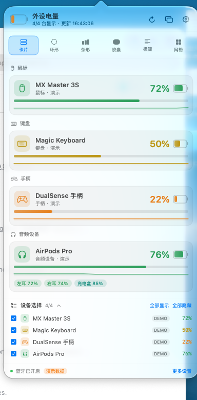
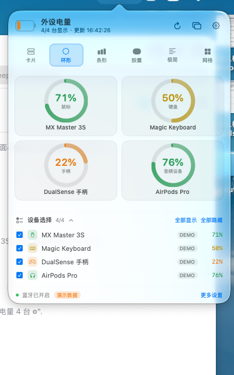
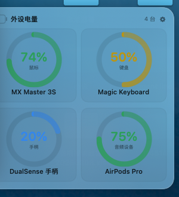
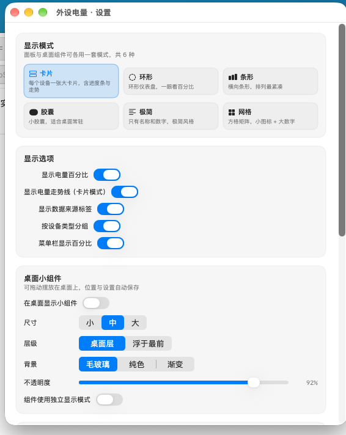
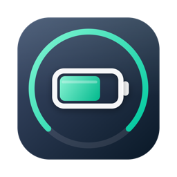

# 外设电量 · PeripheralBattery

[](https://github.com/Ma-yucheng/peripheral-battery/actions/workflows/build.yml)

一个纯本地运行的 macOS 外设电量监控小组件：**实时**读取鼠标、键盘、手柄、耳机的电量，
用 6 种显示模式展示，每台设备都有独立的勾选框，并以 **菜单栏图标 + 桌面小组件** 两种形态常驻。

- **实时**：BLE 走特征值通知（毫秒级）；HID / 手柄 / 系统蓝牙 1–8 秒轮询
- **真实**：直接读系统 API（CoreBluetooth、IOKit、GameController、system_profiler），无任何模拟数据
- **本地**：不联网、不上传、不需要账号，数据不出这台机器
- **原生**：Swift + SwiftUI + AppKit，无 Electron、无浏览器内核



## 功能一览

| 能力 | 说明 |
| --- | --- |
| 实时电量 | 菜单栏图标显示所有勾选设备中的**最低电量**，低于阈值（默认 20%）整体变红 |
| 6 种显示模式 | 卡片 / 环形 / 条形 / 胶囊 / 极简 / 网格，面板与小组件可各选各的 |
| 设备独立勾选 | 每台外设一个复选框，勾掉的设备不参与显示与菜单栏统计，选择会被记住 |
| 桌面小组件 | 贴在桌面层（同原生小组件）、可拖动、可换尺寸、位置记忆 |
| 离线兜底 | 设备休眠时显示最后一次读到的电量（压暗并标注「离线」），不会从列表消失 |
| 电量分量 | AirPods 等设备的左耳 / 右耳 / 充电盒电量分开展示 |
| 走势线 | 卡片模式记录最近 48 个采样点，画出电量变化曲线 |
| 演示模式 | 用 4 台模拟设备预览各模式效果，开关在设置里，条目标注「演示」 |
| 应用图标 | 自绘的深色 squircle + 电量环 + 电池，Finder / Launchpad / 权限弹窗里都能看到 |

## 快速开始

```bash
cd PeripheralBattery
./run.sh          # 编译（如尚未编译）并启动
```

首次启动 macOS 会请求**蓝牙权限**，点「允许」后即可读到真实电量。
（因为本地构建是 ad-hoc 签名，重新编译后系统会再询问一次，属正常现象。）
如果误点了拒绝：系统设置 → 隐私与安全性 → 蓝牙 → 勾选「外设电量」。

只编译不启动：

```bash
./build.sh                       # 产出 build/PeripheralBattery.app
open build/PeripheralBattery.app
```

放进「应用程序」目录长期使用：

```bash
cp -R build/PeripheralBattery.app /Applications/
```

> 换路径后蓝牙权限会重新询问一次（系统按 App 路径记录授权）。
>
> 首次编译（或删掉 `.build` 缓存后）约需 3–6 分钟；之后增量编译会快很多。

## 界面速览

| 环形模式（面板） | 桌面小组件 |
| --- | --- |
|  |  |

| 设置窗口 | 卡片模式详情 |
| --- | --- |
|  |  |

> 截图中的 4 台设备来自「演示模式」。真实数据实测见下方「数据源」。

## 数据源（四路并行 + 自动合并）

| 数据源 | 覆盖设备 | 实现 |
| --- | --- | --- |
| **BLE 电池服务** | 第三方蓝牙鼠标 / 键盘 / 手柄（罗技、雷蛇、Keychron、飞智…） | CoreBluetooth，通过 `retrieveConnectedPeripherals` 复用系统连接，读取 GATT `0x180F` / `0x2A19` 并订阅通知 |
| **IOKit HID** | Apple 原厂 Magic Mouse / Magic Keyboard / Magic Trackpad | IORegistry 中 `AppleDeviceManagementHIDEventService` 的 `BatteryPercent` |
| **GameController** | Xbox、DualSense、DualShock、Switch Pro 等手柄 | `GCController.battery`（含充电状态） |
| **蓝牙系统信息** | AirPods、蓝牙耳机 / 音箱（含左 / 右 / 充电盒） | `system_profiler SPBluetoothDataType` |

同一台设备同时出现在多路数据源时，按可信度合并（BLE > HID > GameController > 系统信息），
界面用 `BLE / HID / GC / BT` 标签标出来源，不会重复出现两条。

**实测（Razer Basilisk X HyperSpeed，蓝牙模式）**：

```
[PB] 1 台: Basilisk X HyperSpeed=32%[BLE]
```

## 六种显示模式

| 模式 | 特点 |
| --- | --- |
| 卡片 | 图标、名称、百分比、进度条、走势线、分量电量，信息最全 |
| 环形 | 2 列环形仪表，环内直接显示百分比，一眼看清 |
| 条形 | 横向条形 + 百分比，纵向最紧凑 |
| 胶囊 | 小胶囊标签，适合桌面常驻小挂件 |
| 极简 | 只有图标、名称和数字，几乎不占地方 |
| 网格 | 小方格矩阵，图标 + 大号数字 |

## 设备独立勾选

- 面板底部「设备选择」：每台外设一行复选框，实时显示百分比与数据来源
- 「全部显示 / 全部隐藏」一键切换
- 勾选状态写入 UserDefaults，重启后保留；**新接入的设备默认自动显示**
- 被勾掉的设备不参与面板、桌面小组件和菜单栏统计

## 桌面小组件

点击面板右上角的 ▣ 按钮（或右键菜单「桌面小组件」）即可把小组件放到桌面：

- **桌面层**（默认）：和 macOS 原生小组件一样贴在桌面，会被普通窗口盖住
- **浮于最前**：始终浮在所有窗口之上，适合一直盯着看
- 拖动任意位置即可移动，位置自动记忆；下次启动回到原处
- 尺寸 小 / 中 / 大，背景 毛玻璃 / 纯色 / 渐变，不透明度可调
- 小组件可以用和面板不同的显示模式

### 为什么不是 WidgetKit 通知中心小组件？

原生 WidgetKit 小组件必须由 Xcode 工程 + 带 Provisioning 的签名构建，并通过 App Group 共享容器；
这台机器只有 Command Line Tools（没有完整 Xcode、没有开发者证书），无法产出能被 `chronod`
识别的 `.appex`。

因此这里用**桌面层无边框 NSPanel + SwiftUI** 实现了行为等价的桌面小组件：桌面层、可拖动、
位置记忆、不抢焦点、跨 Space 保持。视觉与交互和原生桌面小组件一致，且没有 WidgetKit
「最快 15 分钟刷新一次」的限制——这里是**每秒**实时刷新。

后续若拿到 Xcode 与证书，`BatteryStore` 与 `BatteryContent` 可直接复用：
把设备快照写进 App Group 的 `UserDefaults`，再套一层 `TimelineProvider` 即可变成真正的 WidgetKit 小组件。

## 使用说明

- **菜单栏**：电池图标按最低电量填充，右侧显示百分比
- **左键**图标 → 打开面板；**右键** → 菜单（打开面板 / 桌面小组件 / 设置 / 重新扫描 / 退出）
- **设置窗口**：显示模式预览、显示选项、小组件配置、设备勾选、数据源状态、说明
- 面板里 **↻** 立即重新扫描，**▣** 开关桌面小组件，**⚙** 打开设置

## 演示模式

设置 → 数据源 → 打开「演示模式」，用 4 台模拟设备（电量缓慢波动）替换真实数据，
方便预览 6 种模式与小组件效果。演示设备在界面上标注「演示」，不会写入「上次已知电量」缓存。

## 目录结构

```
PeripheralBattery/
├── Sources/
│   ├── Model/          设备模型、显示模式、设置持久化
│   ├── Providers/      BLE / IOKit HID / GameController / system_profiler / 演示数据
│   ├── Store/          多源合并、去重、历史走势、离线缓存
│   ├── UI/             主题、6 种模式、面板、设置、小组件
│   └── App/            菜单栏、弹出面板、小组件窗口
├── Resources/
│   ├── Info.plist
│   └── AppIcon.icns     App 图标（由 tools/make-icon.swift 生成）
├── docs/               README 截图
├── build.sh            编译 .app（ad-hoc 签名）
├── run.sh              编译并启动
├── tools/
│   ├── build-cli.sh    不看界面，在终端直接打印实时电量（自检）
│   ├── build-icon.sh   重新生成 App 图标
│   ├── make-icon.swift 图标绘制脚本（CoreGraphics，矢量缩放）
│   └── cli/main.swift
└── build/PeripheralBattery.app
```

自检数据源是否真的读到电量（不启动界面）：

```bash
./tools/build-cli.sh
```

## 应用图标



图标由 `tools/make-icon.swift` 用 CoreGraphics 直接绘制（不是位图），
一次渲染 16 / 32 / 64 / 128 / 256 / 512 / 1024 全部尺寸并打包成 `AppIcon.icns`。
小尺寸（≤48px）会自动省略量规环、加粗电池轮廓，保证菜单栏 / 列表里依然清晰。

想改配色或形状，编辑脚本后重新生成即可：

```bash
./tools/build-icon.sh
```

## 常见问题

**为什么某些设备显示 `--`？**
部分 2.4G 接收器外设（部分罗技 Unifying、雷蛇 HyperSpeed 2.4G 模式等）不对 macOS 暴露任何电量接口，
系统层面就读不到，属于硬件/驱动限制。切到蓝牙模式通常就能读到。

**会打断鼠标键盘使用吗？**
不会。BLE 读取复用的是系统已建立的连接（`retrieveConnectedPeripherals` + 同一外设上的只读连接），
不会断开或抢占 HID 通道；读完只订阅通知，不做任何写入。

**设备睡着了怎么办？**
蓝牙外设静止一段时间会断开省电，此时列表里显示「离线」+ 最后一次电量（压暗）。
按一下鼠标 / 键盘唤醒后，3 秒内自动恢复实时刷新。

**耗电如何？**
以通知为主、轮询为辅：BLE 每 3 秒读一次，`system_profiler` 每 8 秒一次，HID / 手柄每 2 秒一次。
整体开销低于一个浏览器标签页。

**看不到菜单栏图标？**
这是 `LSUIElement` 应用，没有 Dock 图标。若菜单栏图标被「刘海」挡住在右侧看不到，可精简菜单栏项目。

## 构建要求

- macOS 14.0+，Apple Silicon 或 Intel（`build.sh` 会自动取 `uname -m`）
- Xcode Command Line Tools（`xcode-select --install`），Swift 5.9+
- 不需要完整 Xcode、不需要开发者证书（ad-hoc 签名即可本地运行）

## 协议

[MIT](LICENSE) © 2026 马毓城

## 隐私

- 不联网：代码中没有任何网络请求
- 只读取电量、名称、地址等公开的 HID / GATT 属性
- 设置与「上次已知电量」只存在本机 UserDefaults
